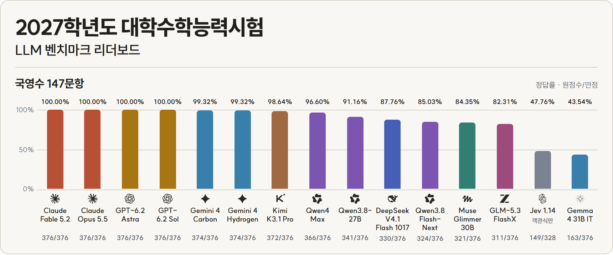

  <a href="https://gonge1018.github.io/27suneung-bench/?year=2027&amp;scope=core">
    <picture>
      <source media="(max-width: 600px) and (prefers-color-scheme: dark)" srcset="docs/assets/2027-scorecard-mobile-dark.png">
      <source media="(max-width: 600px)" srcset="docs/assets/2027-scorecard-mobile-light.png">
      <source media="(prefers-color-scheme: dark)" srcset="docs/assets/2027-scorecard.png">
      
    </picture>
  </a>

  <strong><a href="https://gonge1018.github.io/27suneung-bench/?year=2027&amp;scope=all">전체 리더보드</a></strong>
  &nbsp;·&nbsp;
  <a href="https://gonge1018.github.io/27suneung-bench/?year=2027&amp;scope=core">국영수 성적</a>
  &nbsp;·&nbsp;
  <a href="https://github.com/GonGe1018/27suneung-bench/blob/main/web/public/data/2027/csat/benchmark.json">결과 데이터</a>

<strong>2027학년도 전체 영역</strong> · 8개 모델

<a href="https://gonge1018.github.io/27suneung-bench/?year=2027&amp;scope=korean">국어</a>&nbsp; · &nbsp;<a href="https://gonge1018.github.io/27suneung-bench/?year=2027&amp;scope=math">수학</a>&nbsp; · &nbsp;<a href="https://gonge1018.github.io/27suneung-bench/?year=2027&amp;scope=english">영어</a>&nbsp; · &nbsp;<a href="https://gonge1018.github.io/27suneung-bench/?year=2027&amp;scope=science2">과탐Ⅱ</a>&nbsp; · &nbsp;<a href="https://gonge1018.github.io/27suneung-bench/?year=2027&amp;scope=science1">과탐Ⅰ</a>&nbsp; · &nbsp;<a href="https://gonge1018.github.io/27suneung-bench/?year=2027&amp;scope=social">사탐</a>

| 모델 | 총점 | 정답률 | 국어 | 수학 | 영어 | 과탐Ⅱ | 과탐Ⅰ | 사탐 |
| :--- | ---: | ---: | ---: | ---: | ---: | ---: | ---: | ---: |
| Claude Fable 5.2 | **1,226/1,226** | 100.00% | 124/124 | 152/152 | 100/100 | 200/200 | 200/200 | 450/450 |
| GPT-6.2 Astra | 1,223/1,226 | 99.79% | 124/124 | 152/152 | 100/100 | 200/200 | 197/200 | 450/450 |
| Claude Opus 5.5 | 1,221/1,226 | 99.59% | 124/124 | 152/152 | 100/100 | 200/200 | 195/200 | 450/450 |
| GPT-6.2 Sol | 1,220/1,226 | 99.59% | 124/124 | 152/152 | 100/100 | 200/200 | 197/200 | 447/450 |
| Qwen3.8-27B | 901/1,226 | 73.51% | 105/124 | 136/152 | 100/100 | 147/200 | 85/200 | 328/450 |
| Muse Glimmer 30B | 838/1,226 | 68.17% | 82/124 | 144/152 | 95/100 | 129/200 | 121/200 | 267/450 |
| Gemma 4 31B IT | 352/1,226 | 28.75% | 21/124 | 78/152 | 64/100 | 46/200 | 36/200 | 107/450 |
| Jev 1.14 객관식만 | 312/1,178 | 27.22% | 50/124 | 28/104 | 71/100 | 37/200 | 26/200 | 100/450 |

<strong>2027학년도 국영수</strong> · 15개 모델

| 모델 | 정답률 | 원점수 / 만점 | 응답 |
| :--- | ---: | ---: | ---: |
| Claude Fable 5.2 | 100.00% | 376/376 | 147 |
| Claude Opus 5.5 | 100.00% | 376/376 | 147 |
| GPT-6.2 Astra | 100.00% | 376/376 | 147 |
| GPT-6.2 Sol | 100.00% | 376/376 | 147 |
| Gemini 4 Carbon | 99.32% | 374/376 | 147 |
| Gemini 4 Hydrogen | 99.32% | 374/376 | 147 |
| Kimi K3.1 Pro | 98.64% | 372/376 | 147 |
| Qwen4 Max | 96.60% | 366/376 | 147 |
| Qwen3.8-27B | 91.16% | 341/376 | 147 |
| DeepSeek V4.1 Flash 1017 | 87.76% | 330/376 | 147 |
| Qwen3.8 Flash-Next | 85.03% | 324/376 | 147 |
| Muse Glimmer 30B | 84.35% | 321/376 | 147 |
| GLM-5.3 FlashX | 82.31% | 311/376 | 147 |
| Jev 1.14 객관식만 | 47.76% | 149/328 | 134 |
| Gemma 4 31B IT | 43.54% | 163/376 | 147 |

<strong>2026학년도 성적표 · 전체 영역 487문항</strong>

| 모델 | 정답률 | 정답 / 응답 | 미응답 | 추정 비용 |
| --- | ---: | ---: | ---: | ---: |
| GPT-6.2 Astra | 99.79% | 486 / 487 | 0 | $16.01 |
| Claude Fable 5.2 | 99.57% | 465 / 467 | 20 | $65.68 |
| GPT-6.1 Terra | 99.18% | 364 / 367 | 120 | $2.79 |
| Claude Sonnet 5.5 | 99.14% | 344 / 347 | 140 | $19.02 |
| Claude Opus 5.5 | 99.11% | 443 / 447 | 40 | $38.90 |
| Gemini 4 Hydrogen | 98.70% | 303 / 307 | 180 | $19.46 |
| GPT-6.2 Sol | 98.56% | 480 / 487 | 0 | $3.95 |

정답률은 미응답을 제외합니다. 추정 비용은 재시도를 포함합니다.

[2026학년도 데이터](web/public/data/2026/csat/pilot.json)

<strong>응시 범위와 채점 기준</strong>

| 응시 범위 | 문항 |
| :--- | ---: |
| 국영수 | 147 |
| 국영수와 과학탐구Ⅱ | 227 |
| 전체 영역 | 487 |
| 전체 영역, 수학 객관식 | 474 |

정답률은 응답한 문항 기준이고 원점수에는 문항별 배점을 적용합니다. 국어·수학은 선택과목을 모두 포함하고 공통 문항을 한 번씩 셉니다.

