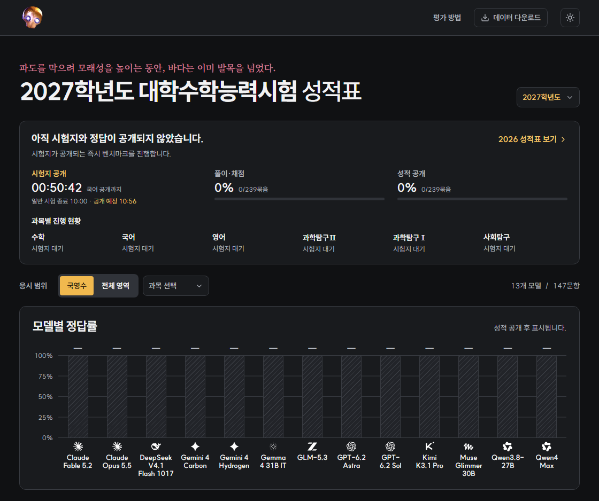

<strong>2027학년도 성적표 · 공개 대기</strong>

| 응시 범위 | 문항 | 응시 예정 모델 · 추론 강도 |
| --- | ---: | --- |
| 국영수 | 147 | Gemini 4 Carbon · high Gemini 4 Hydrogen · xhigh |
| 국영수 + 과학탐구Ⅱ | 227 | Kimi K3.1 Pro · max Qwen4 Max · xhigh DeepSeek V4.1 Flash 1017 · max GLM-5.3 · max |
| 전체 영역 | 487 | GPT-6.2 Astra · max GPT-6.2 Sol · max Claude Fable 5.2 · max Claude Opus 5.5 · max Qwen3.8-27B · xhigh Muse Glimmer 30B · xhigh Gemma 4 31B IT · thinking on |

[2027학년도 데이터](web/public/data/2027/csat/benchmark.json)

<strong>2026학년도 성적표 · 전체 영역 487문항</strong>

| 모델 | 정답률 | 정답 / 응답 | 미응답 | 추정 비용 |
| --- | ---: | ---: | ---: | ---: |
| GPT-6.2 Astra | 99.79% | 486 / 487 | 0 | $16.01 |
| Claude Fable 5.2 | 99.57% | 465 / 467 | 20 | $65.68 |
| GPT-6.1 Terra | 99.18% | 364 / 367 | 120 | $2.79 |
| Claude Sonnet 5.5 | 99.14% | 344 / 347 | 140 | $19.02 |
| Claude Opus 5.5 | 99.11% | 443 / 447 | 40 | $38.90 |
| Gemini 4 Hydrogen | 98.70% | 303 / 307 | 180 | $19.46 |
| GPT-6.2 Sol | 98.56% | 480 / 487 | 0 | $3.95 |

정답률은 미응답을 제외합니다. 추정 비용은 재시도를 포함합니다.

[2026학년도 데이터](web/public/data/2026/csat/pilot.json)

